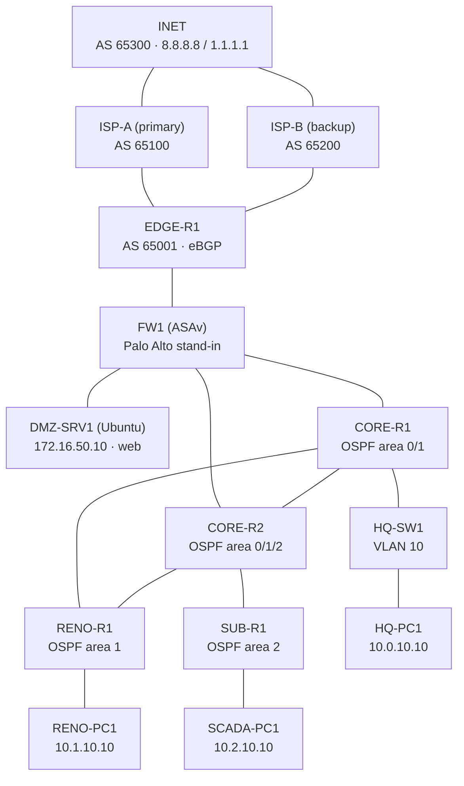

# Ironwood Power & Light (IPL) — NOC Troubleshooting Lab

> Ironwood Power & Light is a **fictional** electric utility. All names, addresses and AS numbers are lab-only (RFC 1918, RFC 5737 documentation ranges and private ASNs).

## Scenario

IPL runs a regional network: an HQ data center, a branch office in Reno, and a substation that carries SCADA traffic. A firewall separates the internal network from a dual-homed internet edge, and a DMZ hosts a public web server.

I work this lab as a **Tier 1 NOC analyst**. The network is built in a known-good state, then faults are introduced. Each fault comes in as a ticket: a symptom with no hint about the cause. I isolate it with show commands, ping and traceroute, then either fix it (Tier 1 scope) or write an escalation note with the evidence.

## Skills demonstrated

- Layer-by-layer isolation: physical, Layer 2, IP, routing, firewall policy, application
- Multi-area OSPF: neighbor states, ABRs, inter-area (O IA) and external (O*E2) routes
- eBGP: neighbor states, best-path selection (local preference, AS-path prepend)
- Firewall triage: zones and security levels, NAT/PAT, ACLs, `packet-tracer` (ASAv as a stand-in for Palo Alto)
- Ticket documentation and escalation notes

## Topology

Editable diagram: [`design/diagrams/IPL_NOC_Topology.drawio`](./design/diagrams/IPL_NOC_Topology.drawio)

## Design summary

- **Internal routing:** OSPF process 1. Area 0 = core, firewall and HQ users; area 1 = Reno (dual-homed to both cores); area 2 = substation (single-homed to CORE-R2).
- **Firewall (FW1):** inside1/inside2 (security 100) to the cores, dmz (50), outside (0). PAT for 10.0.0.0/8; static NAT for the DMZ web server to `198.51.100.10`. Injects the default route into OSPF.
- **Internet edge (EDGE-R1, AS 65001):** eBGP to two ISPs. ISP-A is preferred outbound (local-pref 200) and inbound (AS-path prepend toward ISP-B). Advertises only `198.51.100.0/24`.
- **NOC vantage point:** **HQ-PC1 (10.0.10.10) is the NOC workstation.** "Test from the NOC" means run it from HQ-PC1: it checks the full path a user's traffic takes from HQ.
- **Hosts:** the PCs are IOL nodes with `no ip routing` and a default gateway. **DMZ-SRV1 is an Ubuntu server** (cloud-init build) running a systemd web service on TCP/80, with ufw allowing HTTP from anywhere and SSH only from 10.0.0.0/16. Replaced the original IOL stand-in in the v2 rebuild (see [archived change](./changes/archive/V1-C-20261116002.md)).

Full addressing: [`design/addressing.md`](./design/addressing.md) · Carrier circuits and NOC contacts: [`design/carrier-contacts.md`](./design/carrier-contacts.md) · Design choices: [`design/decisions.md`](./design/decisions.md)

## CML node budget (20-node limit)

| Area | Nodes | Count |
|------|-------|------:|
| Internet | INET, ISP-A, ISP-B | 3 |
| Edge / security | EDGE-R1, FW1, DMZ-SRV1 (Ubuntu) | 3 |
| Core / sites | CORE-R1, CORE-R2, RENO-R1, SUB-R1, HQ-SW1 | 5 |
| Test hosts | HQ-PC1, RENO-PC1, SCADA-PC1 | 3 |
| **Total** | | **14** |

## Build and run

1. CML 2.9 with the main refplat ISO (IOL, IOL-L2, ASAv, Ubuntu). Host VM: 8 vCPU, 20 GB RAM.
2. Import [`configs/IPL-NOC-Baseline.yaml`](./configs/IPL-NOC-Baseline.yaml) and start the lab. FW1 (ASAv) takes 3–5 minutes to boot.
3. FW1 asks you to set an enable password the first time you type `enable`. Then `write memory`.
4. Run the baseline checks in [`verification/baseline.md`](./verification/baseline.md) before working any ticket.

Per-device baseline configs are in [`configs/`](./configs). DMZ-SRV1 builds from [`configs/DMZ-SRV1-cloud-init.yaml`](./configs/DMZ-SRV1-cloud-init.yaml) (admin user `srvadmin`; change the lab password at first login).

Changes to in-service devices are tracked in [`changes/`](./changes). Label/documentation mismatches are in [`known-discrepancies.md`](./known-discrepancies.md): read at the start of each shift.

## Phases

| Phase | Scope | Status |
|-------|-------|--------|
| 1 | OSPF core, firewall, BGP edge: baseline build (v2 rebuild 2026-11-16) | Rebuilt, baseline in progress |
| 2 | Fault tickets (OSPF, BGP, firewall, Layer 2) | In progress |
| 3 | AWS extension: IPsec VPN + BGP to a VPC (CloudFormation) | Planned |

## Tickets

Incidents are classified, escalated and communicated with the **[Incident Response Playbook](https://github.com/poselvy-ai/Incident-Response-Playbook)** (SEV-1 = most severe, ITIL P1–P5).

Workflow and template: [`tickets/README.md`](./tickets/README.md)

| Ticket | Summary | Status |
|--------|---------|--------|
| [TICKET-001](./tickets/TICKET-001.md) | Substation 1 SCADA workstation unreachable: SUB-R1 E0/1 shut down from console | SEV-2 · Resolved, monitoring · [RCA](./tickets/TICKET-001-RCA.md) open (pending Security) |
| [TICKET-002](./tickets/TICKET-002.md) | EDGE-R1 BGP session to ISP-A down | SEV-3 · Escalated to carrier |

### Archived (v1 build)

| Ticket | Summary | Outcome |
|--------|---------|---------|
| [V1-TICKET-001](./tickets/archive/V1-TICKET-001.md) | DMZ-SRV1 unreachable from other subnets | Tier 1 escalation; root cause host-mode ARP / no default route; resolved |
| [V1-TICKET-002](./tickets/archive/V1-TICKET-002.md) | DMZ-SRV1 HTTP service refused connections | IOL stand-in not fit as a web server; replaced with Ubuntu in v2 |

## Version history

| Version | Date | Change |
|---------|------|--------|
| v1 | 2026-11-16 | Initial build. DMZ-SRV1 was an IOL stand-in; two tickets worked (archived) |
| v2 | 2026-11-16 | Rebuilt from scratch: DMZ-SRV1 replaced with an Ubuntu web server, fixes from v1 tickets built in |

## Lessons learned

[`lessons-learned.md`](./lessons-learned.md)
